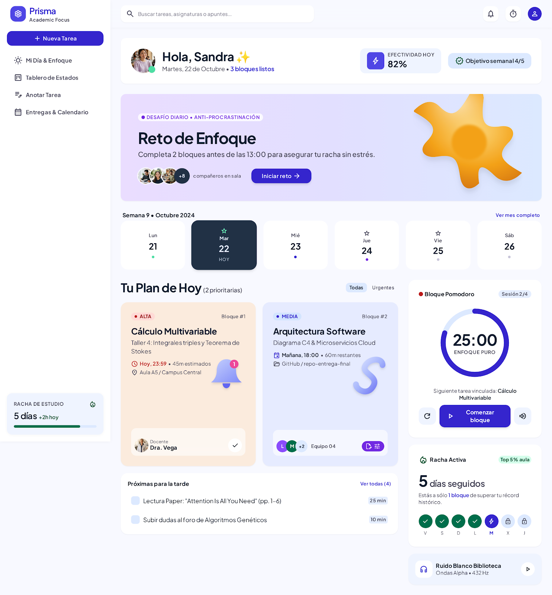
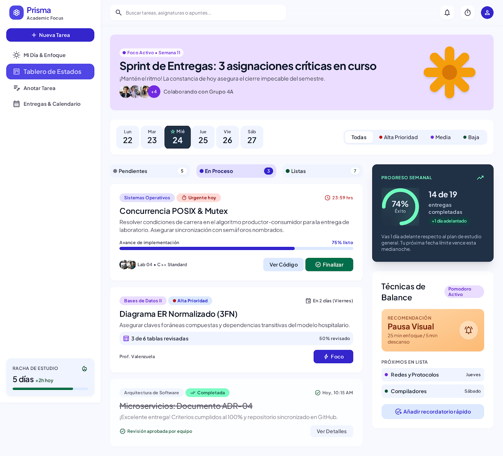
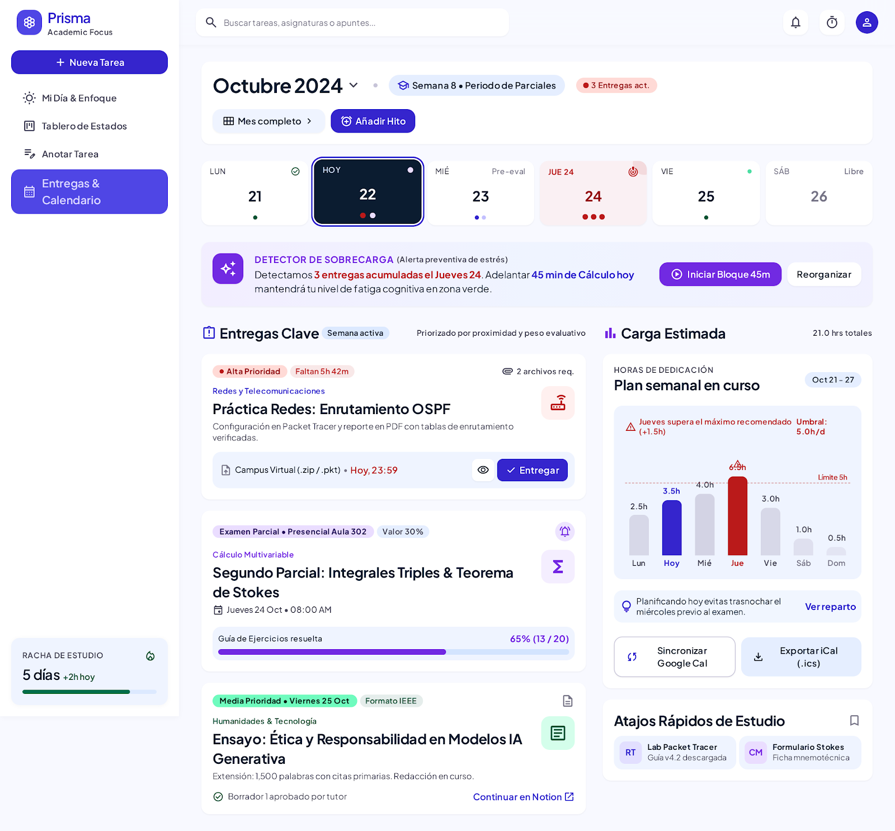
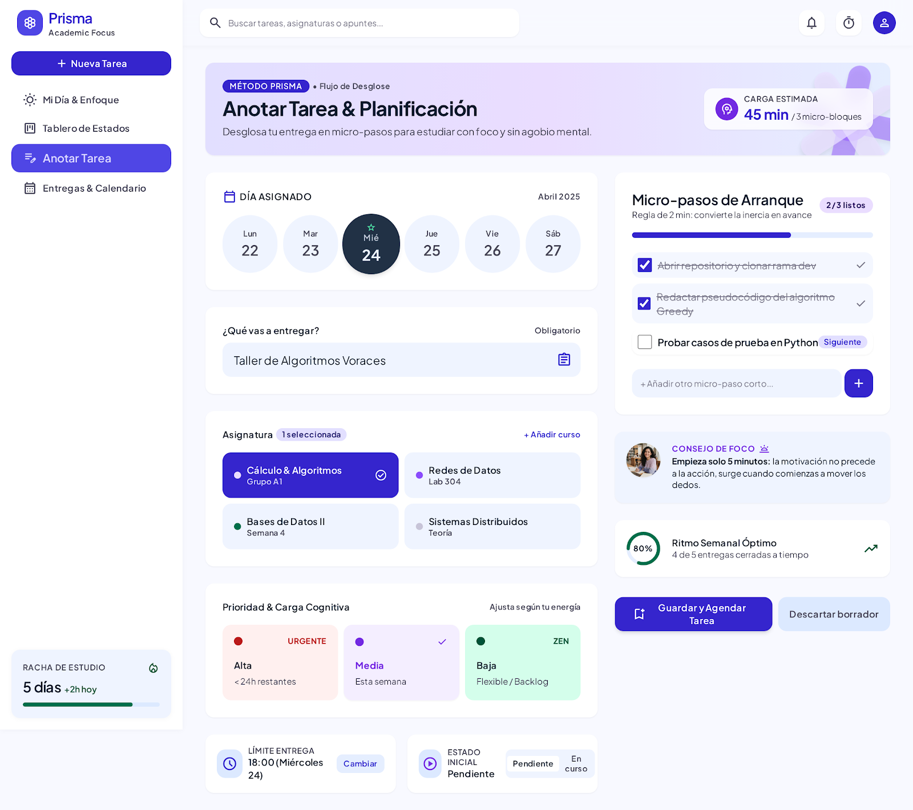

# PRISMA — Academic Focus & Task Manager 🎓

> **Gestor de Tareas y Enfoque para Estudiantes Universitarios** diseñado para combatir la procrastinación, organizar entregas por prioridad y estructurar el estudio mediante micro-pasos de enfoque.



---

## 👥 Roles del Equipo (PRD)

| Rol | Integrante | Responsabilidad Principal |
| :--- | :--- | :--- |
| **Construye** | **Karen Sofia Vargas Fonseca** | Desarrollo frontend, lógica de estado y arquitectura |
| **Producto** | **Julieth Alexandra Ayala Burgos** | Especificación de requisitos, flujo de usuario y PRD |
| **Pruebas** | **Andrea Lizeth Tellez Lopez** | Control de calidad, validación de criterios de aceptación |
| **Publica** | **Isabel Sofia Hernández Pelayo** | Despliegue, documentación y entrega final |

---

## 🎯 Problema y Propósito

Los estudiantes universitarios suelen dejar sus trabajos y actividades para última hora porque no organizan bien su tiempo ni sus prioridades. Esto les genera acumulación de tareas, estrés y dificultades para cumplir con sus responsabilidades académicas.

**Prisma** resuelve esto transformando grandes entregas abrumadoras en **micro-pasos abordables de 15 a 25 minutos**, estructurados con una clara jerarquía visual de prioridades y fechas límite.

---

## 🚀 Funcionalidades Principales

### 1. ✍️ Anotar tareas y fechas de entrega
- Registro rápido de asignaciones con título, asignatura, fecha y hora límite de entrega.
- **Desglose anti-procrastinación**: División de la entrega en micro-pasos accionables para romper la inercia inicial.
- Estimación de tiempo requerido en bloques de enfoque.

### 2. 🎯 Organizar las tareas según su prioridad y fecha límite
- **Semáforo cromático de prioridades**:
  - 🔴 **Alta (Crítica / Urgente):** Exámenes y entregas próximas en menos de 48h.
  - 🟡 **Media:** Tareas semanales regulares e informes en curso.
  - 🟢 **Baja:** Lecturas complementarias e hitos estables.
- **Ordenamiento cronológico automático**: Cálculo dinámico de días restantes con alertas visuales (*"Hoy"*, *"Mañana"*, *"En 3 días"*, *"Atrasada"*).
- Filtros por materia y por nivel de prioridad en tiempo real.

### 3. 📋 Tablero de Estados (Kanban)
Gestión del flujo de progreso en las 3 etapas del PRD:
- 📌 **Pendientes**: Tareas registradas en cola de espera.
- ⏳ **En Proceso**: Asignaciones en desarrollo activo.
- ✅ **Terminadas**: Tareas completadas con efectos visuales de celebración (confetti) y sonido sutil.
- **Interacción**: Soporte completo para **Drag & Drop** (arrastrar y soltar) y botones de cambio rápido de columna.

### 4. 📅 Calendario & Entregas
- Cuadrícula interactiva mensual para visualizar la distribución de entregas.
- Indicadores visuales de carga académica en cada día.
- Cronograma lateral de próximas entregas ordenadas por proximidad.

### 5. ⏱️ Temporizador Pomodoro de Enfoque Profundo
- Modos: **Foco (25 min)**, **Descanso Corto (5 min)** y **Descanso Largo (15 min)**.
- Síntesis de sonido Web Audio API sin librerías externas.
- Sugerencia del siguiente micro-paso de la tarea más urgente para empezar de inmediato.

---

## 🚫 Fuera del Alcance (Lo que NO hace la aplicación)

En estricto cumplimiento del PRD:
- ❌ **No realiza las tareas por el estudiante.**
- ❌ **No entrega trabajos automáticamente.**
- ❌ **No bloquea otras aplicaciones ni exige conectarse con plataformas universitarias.**

---

## 🎨 Sistema de Diseño: *Clarity Spectrum*

- **Tipografía:** *Plus Jakarta Sans* para máxima legibilidad durante sesiones intensas de estudio.
- **Paleta de Colores:**
  - Superficie: `#F8F9FF` / `#FFFFFF`
  - Marca Primaria: `#3525CD` / `#4F46E5`
  - Acento Secundario: `#712AE2`
  - Prioridad Alta: `#EF4444` / `#DC2626`
  - Prioridad Media: `#F59E0B` / `#D97706`
  - Prioridad Baja / Hecho: `#10B981` / `#059669`

---

## 📸 Pantallas de la Aplicación

| Mi Día & Enfoque | Tablero de Estados (Kanban) |
| :---: | :---: |
|  |  |
| **Calendario & Entregas** | **Anotar Tarea & Desglose** |
|  |  |

---

## 💻 Cómo Ejecutar el Proyecto en Local

1. Clona el repositorio o abre la carpeta del proyecto:
   ```bash
   git clone https://github.com/ksvargas-a11y/PRISMA.git
   ```
2. Haz doble clic en `index.html` o ábrelo con cualquier navegador web moderno (Edge, Chrome, Firefox, Opera, etc.).
3. **No requiere instalar Node.js ni compilar nada**. Funciona al 100% de manera autónoma con persistencia en `localStorage`.

---

© 2026 **Prisma**. Desarrollado para la comunidad universitaria.
